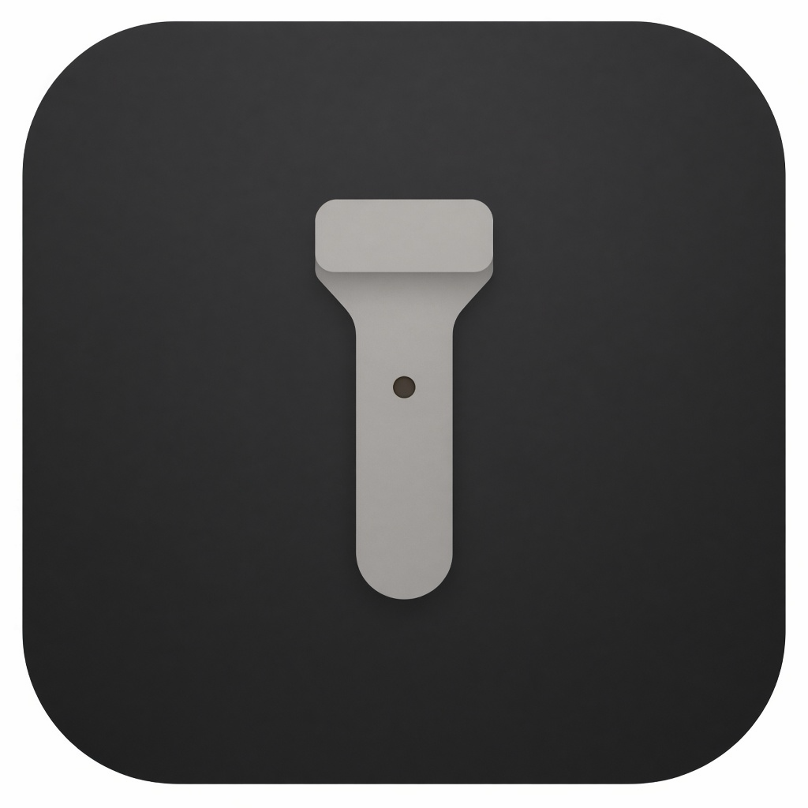

# 暗灯（MagOff）

[](LICENSE)
[](https://github.com/NEX-coding/magoff)
[](https://github.com/NEX-coding/magoff)

**Turn off the MagSafe charger LED. Sleep in the dark.**

菜单栏小工具：一键关掉 MagSafe 充电器指示灯。可选在 ChatGPT / Codex 回复或系统通知时绿橙交叉闪。

<p align="center">
  
</p>

## Download

从 [Releases](https://github.com/NEX-coding/magoff/releases) 下载 `AnDeng-MagOff-*-macos-arm64.zip`，解压后把 **暗灯.app** 拖到「应用程序」。

首次打开若被拦截：右键 App → **打开**。（当前 ad-hoc 签名；欢迎帮做正式公证。）

## One-liner

> Mac 充电时那颗绿/橙灯半夜太亮？用「暗灯」一键关掉。只改灯，不改充电。

> Turn off the MagSafe charger LED on Apple Silicon MacBooks. Charging stays the same.

## Requirements

- Apple Silicon MacBook（MagSafe 3）
- MagSafe cable **with an LED**（纯 USB-C 头没有这颗灯）
- macOS 14+

## Features

| 选项 | 效果 |
|------|------|
| **关闭指示灯** | 灯灭 |
| 系统默认 | 交还 macOS（充满绿、充电橙） |
| 强制绿灯 / 橙灯 | 固定颜色 |
| GPT/Codex 回复时闪烁 | AI 回完 → 交叉闪；切到 ChatGPT/Cursor 即停 |
| 系统通知闪烁（实验性） | 结合窗口、辅助功能和系统日志检测；自动消失后可保持橙灯，处理通知后恢复设定 |

第一次选模式会要管理员密码，安装很小的 LaunchDaemon；插拔充电器后会自动再应用一次。

## Keyboard backlight?

**No effect.** MagOff only writes MagSafe SMC key `ACLC`. Keyboard backlight uses a different path (`CoreBrightness`). Charging power and battery management are untouched.

## How it works

| `ACLC` | Meaning |
|--------|---------|
| 0 | System control |
| 1 | Off |
| 3 | Green |
| 4 | Amber |
| 6 / 7 | Amber blink |

## Build from source

安装 Xcode Command Line Tools（Swift 5.9+），在 Apple Silicon Mac 上构建：

```bash
git clone https://github.com/NEX-coding/magoff.git
cd magoff
./scripts/build.sh
open dist/暗灯.app

# shareable zip + dmg
./scripts/package.sh
```

## Project structure

- `Sources/MagOffApp`：菜单栏界面、通知及本地 AI 完成事件监听。
- `Sources/MagOffCore`：SMC 读写、固定指令和后台服务安装。
- `Sources/MagOffHelper`：后台守护进程，只控制 MagSafe 指示灯。
- `Resources`：图标和 App 元数据。
- `scripts`：构建、打包及需要管理员授权的硬件验证脚本。
- `dist/`、`.build/`：本地产物，不提交到 Git。

## Permissions and privacy

- 首次安装或修复后台服务需要管理员授权。服务位于 `/Library/Application Support/MagOff`，由 LaunchDaemon 启动；后续切换模式通过本地模式/命令文件完成。
- 当前模式和命令文件允许本机其他账户写入，仅接受预定义灯光命令；它们不能用于执行任意 Shell 命令。多用户电脑需考虑这一点。
- 基础灯光控制不需要读取聊天记录。可关闭菜单中的 AI 回复闪烁和通知闪烁选项。
- AI 回复闪烁默认开启：本地读取 `~/.codex/sessions` 完成事件，并以只读方式查询 `~/.codex/sqlite/codex.db` 的更新时间。检测到的是活动信号，可能出现误触发。
- 系统通知闪烁默认关闭：启用后使用窗口信息、辅助功能及本机 Notification Center 日志检测横幅；不上传这些数据。系统版本、通知设置和应用自定义横幅会影响识别。
- macOS 14+ 是构建目标，当前未提供所有机型及系统版本的实测兼容保证。SMC `ACLC` 属于未公开接口，系统升级后可能改变。

## Troubleshooting and verification

1. 选择「系统默认」可交还灯光控制；「恢复设定模式」用于取消通知后的橙灯保持。
2. 旧版本升级后若切换模式无效，可从新 App 卸载后台服务，再选择模式重新安装。
3. 构建后可运行只读检查（不会切换灯光）：

   ```bash
   "dist/暗灯.app/Contents/Helpers/magoff-helper" --probe
   "dist/暗灯.app/Contents/Helpers/magoff-helper" --status
   ```

4. `./scripts/repair-and-test.sh` 会请求管理员授权、重装服务、实际闪灯并重启 App；仅在你准备测试连接的 MagSafe 时手动运行。

版本变化见 [CHANGELOG.md](CHANGELOG.md)。二进制采用 ad-hoc 签名，尚未进行 Apple 公证；若系统拦截，请在系统隐私与安全设置中核实来源后允许打开。

## Promo kit

多平台文案（X / 小红书 / 抖音）：见 [`promo/`](promo/).

## Uninstall

菜单「卸载后台服务…」，或：

```bash
sudo launchctl bootout system/com.nex.magoff.helper 2>/dev/null || true
sudo rm -f /Library/LaunchDaemons/com.nex.magoff.helper.plist
sudo rm -f "/Library/Application Support/MagOff/magoff-helper"
```

## License

[MIT](LICENSE)
